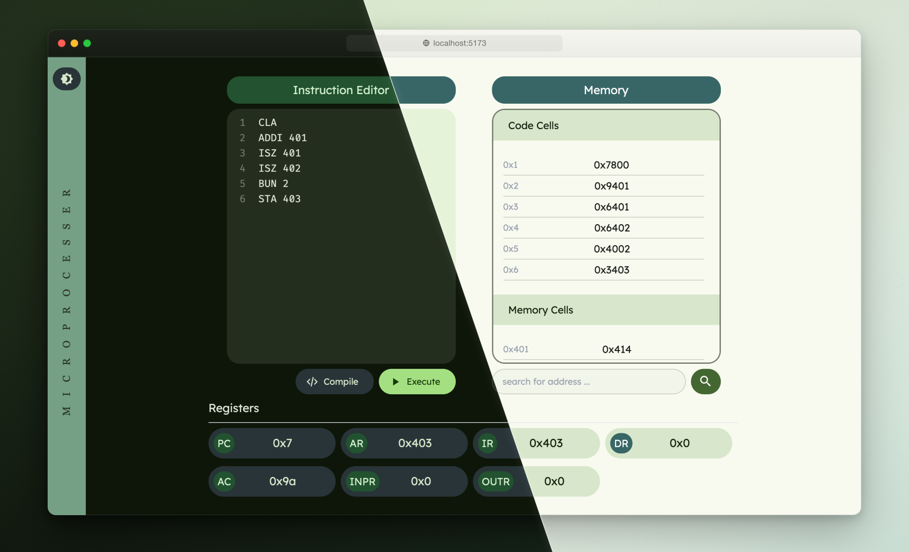
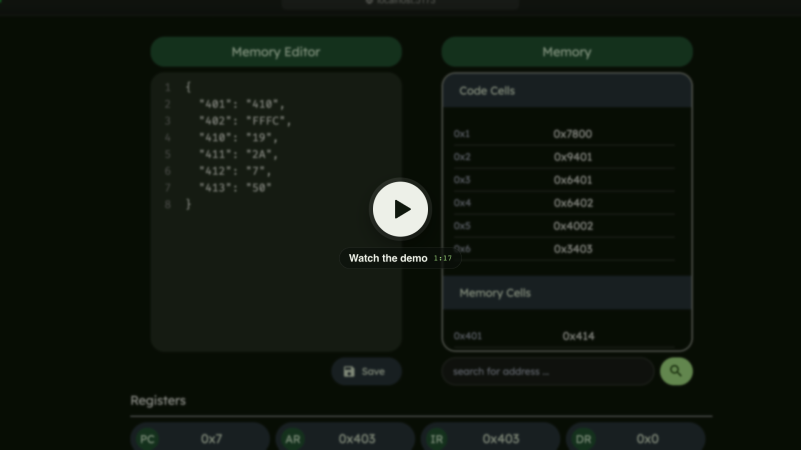
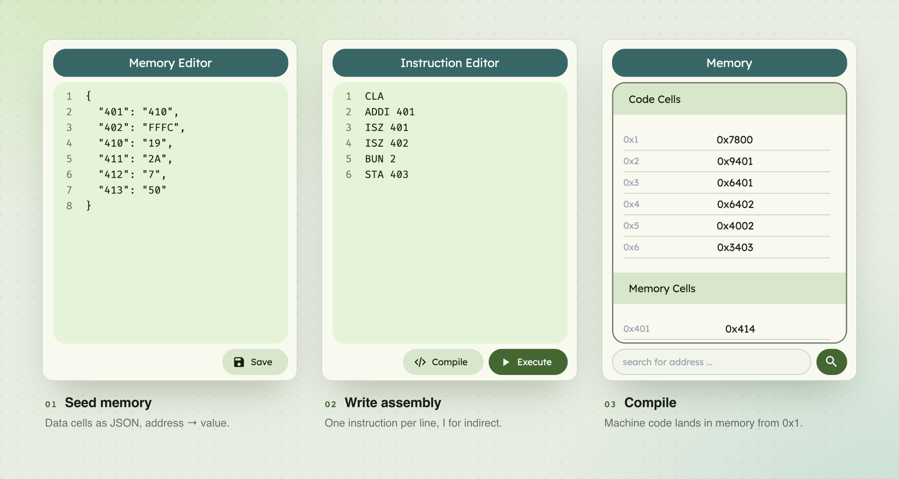
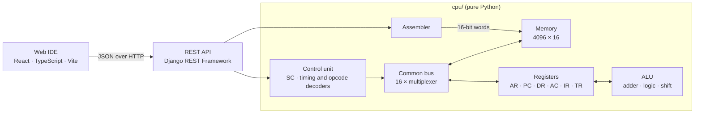

<div align="center">

<h1>CPU Simulation</h1>

<p><b>Mano's Basic Computer, simulated in Python and driven from the browser.</b><br>
Write assembly, compile it to machine code, run it, and watch memory and registers change.</p>

<p>
  <a href="#getting-started">Getting started</a>&nbsp;&nbsp;·&nbsp;&nbsp;
  <a href="#how-it-works">How it works</a>&nbsp;&nbsp;·&nbsp;&nbsp;
  <a href="#instruction-set">Instruction set</a>&nbsp;&nbsp;·&nbsp;&nbsp;
  <a href="#architecture">Architecture</a>
</p>

<p>
  
  
  
  
</p>

</div>



<br>

The **Basic Computer** from M. Morris Mano's *Computer System Architecture* is the 16-bit machine
most of us first meet in a computer architecture course. This project builds it in software out of
bit-level parts (registers, multiplexers, decoders and full adders) and puts a small web IDE on top.
You can step through the textbook's examples without drawing a single timing diagram by hand.

## Demo

<a href="docs/assets/demo.mp4">
  
</a>

<sub>A guided 77-second walkthrough: seed memory, write a loop in assembly, compile it, run it, check the result, and switch themes.</sub>

## Highlights

- **Bit-level datapath.** Every register, the 16-bit common bus (one multiplexer per bit) and the ALU's arithmetic, logic and shift units operate on lists of bits, not Python integers.
- **Hardwired control unit.** A sequence counter feeds a timing decoder (T0–T15) and an opcode decoder (D0–D7). Each control signal is a Boolean expression of `T`, `D`, `I` and the IR bits, written the way the textbook writes them.
- **Assembler.** Mnemonics become 16-bit words, with direct and indirect addressing for memory-reference instructions.
- **Web IDE.** An instruction editor, a JSON memory editor, a searchable memory view split into code and data cells, and a register panel. It follows your OS's light or dark theme, and there's a manual toggle too.
- **Small REST API.** Django REST Framework wraps a single CPU instance, so the core stays dependency-free.

## How it works

<picture>
  <source media="(prefers-color-scheme: dark)" srcset="docs/assets/workflow-dark.png">
  
</picture>

The demo program adds up an array of four numbers using a pointer and a counter.

**1. Seed the data memory.** Toggle the editor by clicking its title, then save address/value pairs (hex):

```json
{
  "401": "410",
  "402": "FFFC",
  "410": "19",
  "411": "2A",
  "412": "7",
  "413": "50"
}
```

`0x401` is a pointer to the array at `0x410`, and `0x402` is a counter that starts at −4 (`0xFFFC`).

**2. Write the program.** One instruction per line:

```text
CLA
ADDI 401
ISZ 401
ISZ 402
BUN 2
STA 403
```

| Line | Instruction | What it does |
| :-- | :-- | :-- |
| 1 | `CLA` | Clear the accumulator |
| 2 | `ADDI 401` | Indirect add: `AC ← AC + M[M[0x401]]` |
| 3 | `ISZ 401` | Advance the pointer |
| 4 | `ISZ 402` | Count up toward zero and skip line 5 when the counter reaches it |
| 5 | `BUN 2` | Loop back to line 2 |
| 6 | `STA 403` | Store the sum |

**3. Compile** writes the machine code into memory, starting at `0x1` (`0x0` is reserved for the interrupt return address).

**4. Execute** clears the registers, sets `PC = 1` and runs the control unit until the program counter passes the last instruction. `AC` ends at `0x9A` (25 + 42 + 7 + 80 = 154), and the same value is stored at `0x403`.

The core works without the web UI too:

```python
from cpu.main import CPU
from cpu.utils.binary import dec_to_binlist

cpu = CPU()
cpu.compile(["CLA", "ADDI 401", "ISZ 401", "ISZ 402", "BUN 2", "STA 403"])

data = {0x401: 0x410, 0x402: 0xFFFC, 0x410: 0x19, 0x411: 0x2A, 0x412: 0x7, 0x413: 0x50}
for address, value in data.items():
    cpu.memory.write(dec_to_binlist(value, 16), address)

cpu.execute()
print(cpu.cu.get_registers()["AC"])  # 0x9a
```

## Instruction set

The full Basic Computer instruction set. Memory-reference instructions take a 12-bit hex address.
Append `I` to the mnemonic for indirect addressing, as in `LDAI 2F0`.

<table>
<tr><th>Memory reference</th><th>Register reference</th><th>Input / output</th></tr>
<tr valign="top"><td>

| | Direct | Indirect |
| :-- | :-- | :-- |
| `AND` | `0xxx` | `8xxx` |
| `ADD` | `1xxx` | `9xxx` |
| `LDA` | `2xxx` | `Axxx` |
| `STA` | `3xxx` | `Bxxx` |
| `BUN` | `4xxx` | `Cxxx` |
| `BSA` | `5xxx` | `Dxxx` |
| `ISZ` | `6xxx` | `Exxx` |

</td><td>

| | Code |
| :-- | :-- |
| `CLA` | `7800` |
| `CLE` | `7400` |
| `CMA` | `7200` |
| `CME` | `7100` |
| `CIR` | `7080` |
| `CIL` | `7040` |
| `INC` | `7020` |
| `SPA` | `7010` |
| `SNA` | `7008` |
| `SZA` | `7004` |
| `SZE` | `7002` |
| `HLT` | `7001` |

</td><td>

| | Code |
| :-- | :-- |
| `INP` | `F800` |
| `OUT` | `F400` |
| `SKI` | `F200` |
| `SKO` | `F100` |
| `ION` | `F080` |
| `IOF` | `F040` |

</td></tr>
</table>

## Architecture



| Register | Bits | | Register | Bits | |
| :-- | --: | :-- | :-- | --: | :-- |
| `AR` | 12 | Address | `AC` | 16 | Accumulator |
| `PC` | 12 | Program counter | `TR` | 16 | Temporary |
| `DR` | 16 | Data | `INPR` | 8 | Input |
| `IR` | 16 | Instruction | `OUTR` | 8 | Output |

Flags: `E` (carry), `R` (interrupt cycle), `IEN`, `FGI`, `FGO`.

## Getting started

You'll need **Python 3.10+** and **Node.js 18+**.

```bash
git clone https://github.com/cpu-simulation/simulation-microprocessors.git
cd simulation-microprocessors
```

**Backend** (port 8000)

```bash
python -m venv .venv && source .venv/bin/activate
pip install -e .                          # makes the cpu package importable
pip install -r backend/requirements.txt
python backend/manage.py runserver
```

**Frontend** (port 5173), in a second terminal

```bash
cd frontend
npm install
npm run dev
```

Open **http://localhost:5173**. The backend's CORS settings allow that origin, and the frontend reads
the API address from `frontend/src/lib.ts`.

### API

| Method | Endpoint | |
| :-- | :-- | :-- |
| `POST` | `/core/compile` | `{"instructions": ["CLA", "ADDI 401", …]}`. Assembles into memory from `0x1` |
| `GET` | `/core/instruction` | Resets the registers and runs the program |
| `GET` | `/memory/read` | Non-zero cells as `[{"address": "0x401", "value": "0x410"}, …]` |
| `POST` | `/memory/write` | `[{"address": "401", "value": "410"}, …]` (hex) |
| `GET` | `/register/read` | `{"PC": "0x7", "AR": "0x403", "AC": "0x9a", …}` |

## Project structure

```text
.
├── cpu/                  the simulated machine, standard library only
│   ├── components/       register, mux, decoder, encoder, sequence counter, flags
│   │   └── ALU/          full/half adders, arithmetic, logic and shift units
│   ├── utils/            bit helpers, opcode tables, bus and ALU select codes
│   ├── bus.py            16-bit common bus
│   ├── ALU.py
│   ├── memory.py         4096 × 16-bit words
│   ├── compiler.py       assembler
│   ├── cu.py             hardwired control unit
│   └── main.py           wires the parts into a CPU
├── backend/              Django + DRF API around one CPU instance
└── frontend/             React web IDE
```

## Notes

- The assembler expects exactly one instruction per line. Labels, comments and blank lines aren't supported, and assembly errors are logged by the backend instead of shown in the UI.
- `HLT` assembles but doesn't stop the run; execution ends when `PC` moves past the last instruction.
- The backend keeps a single CPU in memory, shared by every client. Restart it to start from a clean machine.
- `INP`, `OUT` and the I/O flags are decoded by the control unit, but there's no input device in the UI yet.

## Team

Built as a computer architecture course project by
[Mohammad Mallaee](https://github.com/mohammad-mallaee),
[Davoud Nosrati](https://github.com/ausdavoud) and
[Amin Masoudi](https://github.com/AminMasoudi).

Based on the Basic Computer in M. Morris Mano, *Computer System Architecture*, 3rd edition, chapter 5.

## License

[MIT](LICENSE)
